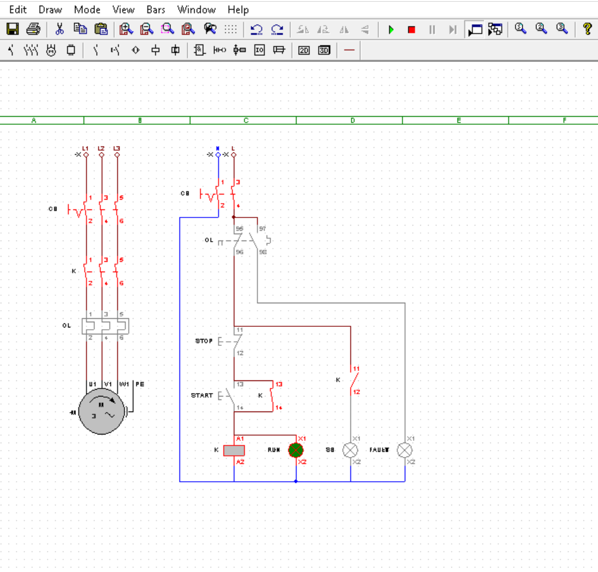

# Direct-On-Line (DOL) Motor Starter

A simulated direct-on-line starter for a three-phase induction motor, with start/stop control, overload protection and run, standby and fault indication.

**Tool:** CADe_SIMU | **Status:** Simulated | **Motor supply:** 3-phase | **Control supply:** single-phase

## Overview

A DOL starter connects the motor straight to the supply through one contactor. It is the simplest starting method and the base for the other projects in this collection. The circuit has two parts: a **power circuit** (3-phase, to the motor) and a **control circuit** (single-phase, which decides when the contactor closes).

## Circuit diagram



## Components

| Label | Component | Function |
|---|---|---|
| CB (power) | Circuit breaker | Isolates and protects the 3-phase supply |
| K | Contactor (power contacts 1-2, 3-4, 5-6) | Switches the motor on and off |
| OL | Thermal overload relay | Protects the motor from sustained overload |
| M | 3-phase induction motor (U1, V1, W1, PE) | The load |
| CB (control) | 2-pole circuit breaker | Protects the control circuit |
| STOP | Pushbutton, normally closed (NC) 11-12 | Stops the motor |
| START | Pushbutton, normally open (NO) 13-14 | Starts the motor |
| K 13-14 | Contactor auxiliary contact (NO) | Seal-in (holding) contact |
| K coil | Contactor coil A1-A2 | Closes the power contacts when energised |
| OL 95-96 | Overload auxiliary contact (NC) | Opens the control circuit on overload |
| OL 97-98 | Overload auxiliary contact (NO) | Closes to light the FAULT lamp |
| RUN | Lamp (green) | Motor running |
| SB | Lamp | Standby (motor stopped) |
| FAULT | Lamp | Overload tripped |

## How it works

1. With the breakers closed, the control circuit is live and the **SB** lamp shows the starter is ready (K is off, so its NC contact 11-12 is closed).
2. Press **START**. Current flows through OL 95-96, the STOP contact and the START contact to the **K coil**.
3. K closes its power contacts and the motor runs. At the same time K's auxiliary contact 13-14 closes in parallel with START. This is the **seal-in**, which keeps the coil on after START is released.
4. The **RUN** lamp (wired across the coil) turns on and the SB lamp turns off.
5. Press **STOP**. The coil circuit opens, K drops out and the motor stops.
6. If the motor overloads, the OL relay trips. Contact 95-96 opens and drops the coil. Contact 97-98 closes and lights the **FAULT** lamp. Reset the relay before restarting.

## Protection

- **Overload:** thermal relay OL stops the motor on sustained overcurrent.
- **Short circuit:** the upstream circuit breakers.
- **Fail-safe stop:** STOP and OL are normally closed contacts in series, so a broken wire or a tripped relay stops the motor.

## Running the simulation

1. Open the project file in [CADe_SIMU](https://www.cadesimu.net/).
2. Click the green **Run** button on the toolbar.
3. Click START and STOP on the diagram. To test the fault path, click the OL relay to simulate a trip.

## Possible improvements

- Add a start delay or a remote start/stop.
- Add an emergency stop in series with STOP.
- Add a phase failure relay on the 3-phase supply.

## Skills demonstrated

Power and control circuit separation, contactor seal-in logic, overload protection, status lamp wiring, reading and drawing motor control schematics.

## Files

```
01-direct-on-line-starter/
├── README.md
├── dol-starter.cad        (add your CADe_SIMU project file here)
└── images/circuit-diagram.png
```

## Author

Nifemi Akintoye ([GitHub](https://github.com/attomm))

> This is a learning simulation. Real motor circuits must be designed and installed by a qualified electrician in line with local wiring regulations.
