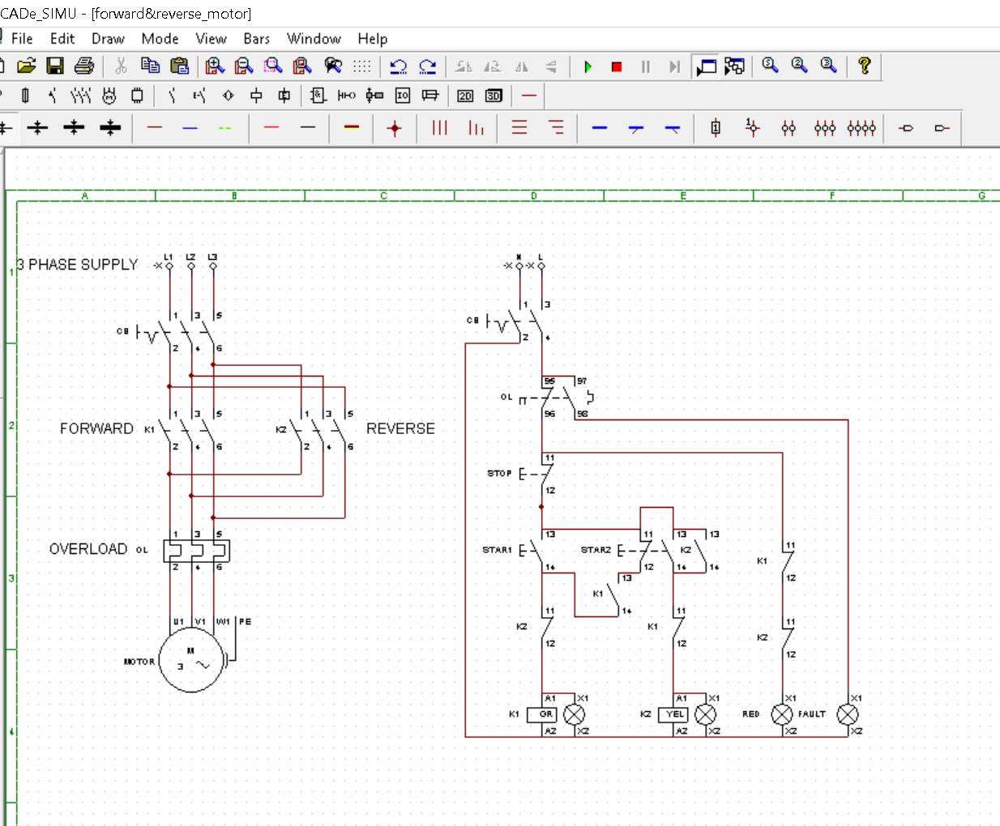

# Forward/Reverse Motor Control (Direct Reversal Button)

A simulated forward/reverse starter in which the second start button turns a running motor to reverse without first pressing STOP.

**Tool:** CADe_SIMU | **Status:** Simulated | **Motor supply:** 3-phase | **Control supply:** single-phase

## Overview

This builds on the basic forward/reverse starter. Contactor **K1** runs the motor forward and **K2** swaps two phases for reverse. The difference is the **START2** button, which has two contacts: a normally open one that starts reverse and a normally closed one in the forward holding circuit. Pressing START2 breaks K1's seal-in, so K1 drops out and K2 takes over.

## Circuit diagram



## Components

| Label | Component | Function |
|---|---|---|
| CB | Circuit breaker (power) | Isolates and protects the 3-phase supply |
| K1 (FORWARD) | Forward contactor | Normal phase sequence |
| K2 (REVERSE) | Reverse contactor | Two phases swapped |
| OL (OVERLOAD) | Thermal overload relay | Motor overload protection |
| MOTOR | 3-phase induction motor | The load |
| CB (control) | 2-pole circuit breaker | Protects the control circuit |
| OL 95-96 / 97-98 | Overload auxiliary contacts | Drop the control circuit; light the FAULT lamp |
| STOP | Pushbutton (NC) | Stops the motor |
| START1 | Pushbutton (NO) | Starts forward |
| START2 | Double-contact pushbutton (NC 11-12 and NO 13-14) | Changes to reverse |
| K1 13-14, K2 13-14 | Auxiliary contacts (NO) | Seal-in contacts |
| K1 11-12, K2 11-12 | Auxiliary contacts (NC) | Electrical interlocks |
| GR, YEL | Lamps on K1 and K2 | Forward running (green), reverse running (yellow) |
| RED | Lamp | Neither contactor on (stopped) |
| FAULT | Lamp | Overload tripped |

## How it works

1. **Forward:** press START1. K1 is energised, seals itself in through its 13-14 contact and the START2 NC contact, and the motor runs forward. The green lamp turns on.
2. **Direct reversal:** press START2. Its NC contact opens the K1 holding circuit and K1 drops out. Once K1's interlock contact returns closed, K2 is energised through START2's NO contact, seals in and runs the motor in reverse. The yellow lamp turns on.
3. **Back to forward:** press STOP, then START1. The START1 button has no NC contact in the reverse circuit, so in this design the reverse direction is exited with STOP.
4. **Overload:** the OL relay trips, drops the control circuit and lights the FAULT lamp.

## Interlocking

| Rule | How it is enforced |
|---|---|
| K1 and K2 never on together | K2 NC in K1's coil path; K1 NC in K2's coil path |
| Forward to reverse without STOP | START2's NC contact breaks K1's holding circuit |
| Overload stops everything | OL 95-96 is in series with the whole control circuit |

## Limitation to be aware of

Changing direction at full speed puts high stress on the motor and mechanics, because the motor has to reverse against its own momentum. For larger or high-inertia loads, add a time delay or require a stop first, as in the separate-button version.

## Running the simulation

1. Open the project file in [CADe_SIMU](https://www.cadesimu.net/).
2. Click **Run**.
3. Press START1, then START2 to see the direct reversal. Press STOP and test START1 again.

## Possible improvements

- Add a delay or braking step before reversal.
- Add a matching double-contact button for reverse-to-forward.
- Add an emergency stop and a mechanical interlock on the contactors.

## Skills demonstrated

Three-phase reversing, double-contact pushbutton logic, interlocking, seal-in circuits, overload protection.

## Files

```
04-forward-reverse-direct-reversal/
├── README.md
├── forward-reverse-direct.cad   (add your CADe_SIMU project file here)
└── images/circuit-diagram.png
```

## Author

Nifemi Akintoye ([GitHub](https://github.com/attomm))

> This is a learning simulation. Real motor circuits must be designed and installed by a qualified electrician in line with local wiring regulations.
