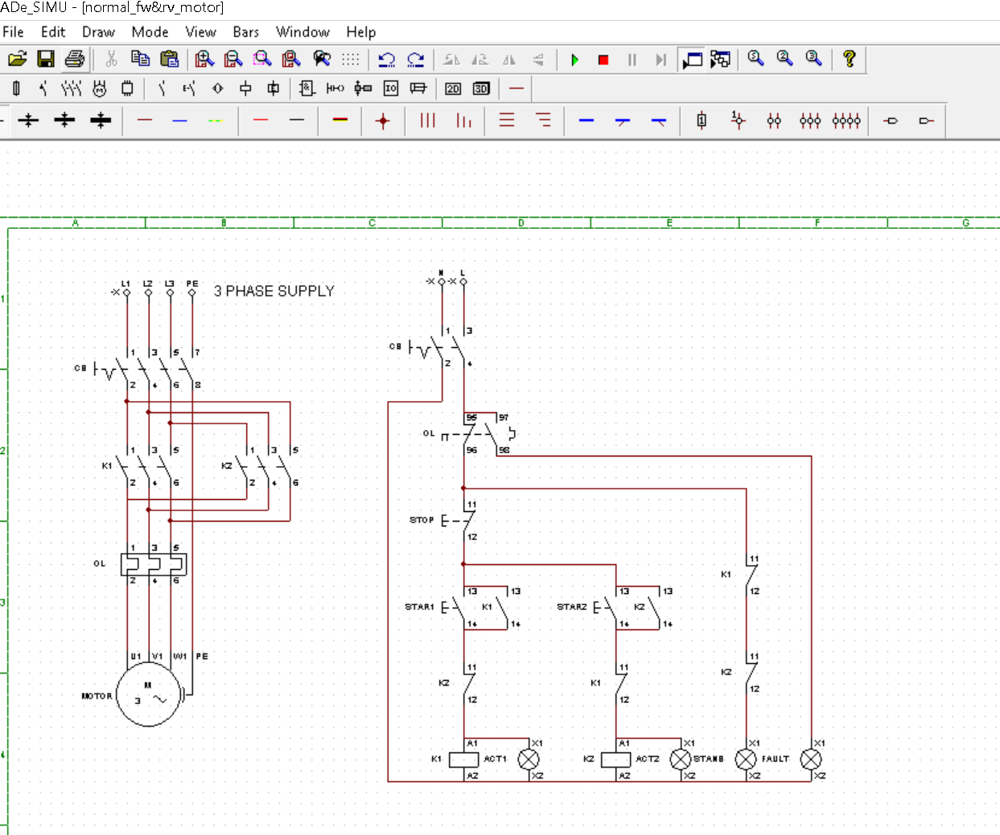

# Forward/Reverse Motor Control (Separate Start Buttons)

A simulated forward/reverse starter for a three-phase motor with a separate START button for each direction, electrical interlocking and status lamps.

**Tool:** CADe_SIMU | **Status:** Simulated | **Motor supply:** 3-phase | **Control supply:** single-phase

## Overview

Reversing a three-phase motor means swapping any two supply phases. This circuit uses two contactors: **K1** connects the phases normally (forward) and **K2** swaps two of them (reverse). If both contactors closed together, the phases would be shorted, so each contactor's normally closed contact is wired into the other's coil circuit as an **electrical interlock**. To change direction, the operator must press STOP first.

## Circuit diagram



## Components

| Label | Component | Function |
|---|---|---|
| CB | Circuit breaker (power) | Isolates and protects the 3-phase supply |
| K1 | Forward contactor | Connects the motor for forward rotation |
| K2 | Reverse contactor | Swaps two phases for reverse rotation |
| OL | Thermal overload relay | Protects the motor from overload |
| MOTOR | 3-phase induction motor (U1, V1, W1, PE) | The load |
| CB (control) | 2-pole circuit breaker | Protects the control circuit |
| OL 95-96 / 97-98 | Overload auxiliary contacts (NC / NO) | Drop the control circuit and light the FAULT lamp |
| STOP | Pushbutton (NC) | Stops the motor |
| START1 / START2 | Pushbuttons (NO) | Start forward / start reverse |
| K1 13-14, K2 13-14 | Auxiliary contacts (NO) | Seal-in contacts for each direction |
| K1 11-12, K2 11-12 | Auxiliary contacts (NC) | Electrical interlocks |
| ACT1, ACT2 | Lamps | Forward running, reverse running |
| STANDBY | Lamp | Neither contactor is on |
| FAULT | Lamp | Overload tripped |

## How it works

1. **Forward:** press START1. K1 is energised through STOP, the overload contact and the K2 interlock. K1 seals itself in with its 13-14 contact, the motor runs forward and the ACT1 lamp turns on.
2. K1's NC contact opens in the K2 branch. START2 now has no effect while K1 is on.
3. **Stop:** press STOP. K1 drops out and the motor stops.
4. **Reverse:** press START2. K2 is energised, seals in, and two phases are swapped at the motor. The motor runs in reverse and ACT2 turns on. K2's NC contact now blocks K1.
5. **Standby lamp:** the lamp is fed through K1 NC and K2 NC in series, so it only lights when both are off.
6. **Overload:** the OL relay trips, drops the control circuit and lights the **FAULT** lamp.

## Interlocking

| Rule | How it is enforced |
|---|---|
| K1 and K2 never on together | K2 NC in series with K1's coil; K1 NC in series with K2's coil |
| Reverse only after stopping | START1/START2 cannot override the interlock, so STOP is needed to change direction |
| Overload stops both directions | OL 95-96 is in series with the whole control circuit |

## Running the simulation

1. Open the project file in [CADe_SIMU](https://www.cadesimu.net/).
2. Click **Run**.
3. Press START1, then try START2 (nothing happens). Press STOP, then START2 to reverse.

## Possible improvements

- Add a mechanical interlock between K1 and K2 contactors in a real panel.
- Add a short delay before reversing so the motor can slow down.
- Add an emergency stop in series with STOP.

## Skills demonstrated

Three-phase reversing, electrical interlocking, seal-in logic, overload protection, status indication.

## Files

```
03-forward-reverse-separate-start-buttons/
├── README.md
├── forward-reverse.cad   (add your CADe_SIMU project file here)
└── images/circuit-diagram.png
```

## Author

Nifemi Akintoye ([GitHub](https://github.com/attomm))

> This is a learning simulation. Real motor circuits must be designed and installed by a qualified electrician in line with local wiring regulations.
