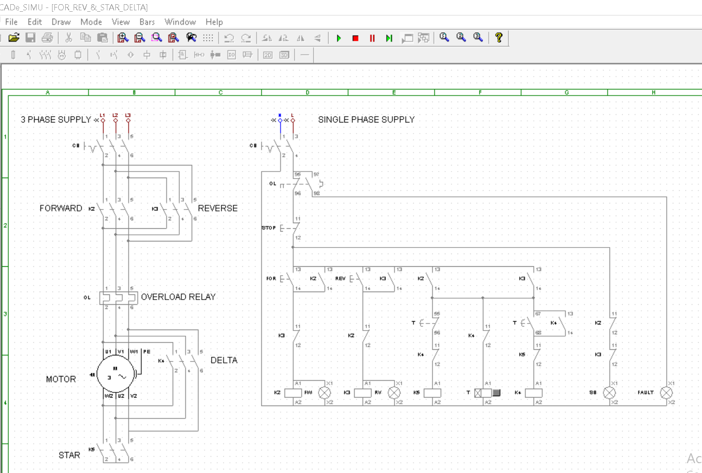

# Forward/Reverse Motor Control with Star-Delta Starting

A simulated starter that combines direction control (forward and reverse) with automatic star-delta reduced-voltage starting for a three-phase motor.

**Tool:** CADe_SIMU | **Status:** Simulated | **Motor supply:** 3-phase | **Control supply:** single-phase

## Overview

This project joins two earlier ideas: reversing contactors that swap two phases, and a star-delta starter that limits starting current. The user chooses a direction with the FOR or REV button, and the star-delta sequence then runs automatically for either direction.

The motor must be wound for delta operation at the supply voltage, with all six winding terminals available.

## Circuit diagram



## Components

| Label | Component | Function |
|---|---|---|
| CB | Circuit breaker (power) | Isolates and protects the 3-phase supply |
| K2 (FORWARD) | Forward contactor | Normal phase sequence |
| K3 (REVERSE) | Reverse contactor | Two phases swapped |
| OL (OVERLOAD RELAY) | Thermal overload relay | Motor overload protection |
| MOTOR | 3-phase motor (U1, V1, W1, W2, U2, V2) | The load |
| K5 (STAR) | Star contactor | Joins W2, U2, V2 for the starting stage |
| K4 (DELTA) | Delta contactor | Connects the windings in delta for running |
| T | On-delay timer | Sets the time spent in star |
| CB (control) | 2-pole circuit breaker | Protects the single-phase control supply |
| STOP | Pushbutton (NC) | Stops the motor |
| FOR / REV | Pushbuttons (NO) | Start forward / start reverse |
| K2 13-14, K3 13-14 | Auxiliary contacts (NO) | Seal-in contacts, and they start the star-delta stage |
| K2 11-12, K3 11-12 | Auxiliary contacts (NC) | Direction interlocks |
| T 55-56 / T 67-68 | Timer contacts (NC and NO) | Star drops out / delta comes in after the delay |
| K4 and K5 11-12 | Auxiliary contacts (NC) | Interlocks between star and delta |
| FW, RV | Lamps | Forward, reverse running |
| SB | Lamp | Standby (motor stopped) |
| FAULT | Lamp | Overload tripped |

## How it works

1. **Choose a direction:** press FOR or REV. K2 (forward) or K3 (reverse) is energised through STOP, the overload contact and the opposite direction's interlock. It seals itself in, and the FW or RV lamp turns on.
2. **Star stage:** the closed auxiliary contact of the direction contactor feeds the star-delta section. The timer T and the star contactor K5 are energised, so the motor starts in star on reduced voltage.
3. **Changeover:** after the timer delay, T 55-56 opens and K5 drops out. T 67-68 closes, K4 (delta) is energised through K5's NC contact and seals itself in.
4. **Delta stage:** the motor runs in delta at full voltage. K4's NC contact switches off the timer.
5. **Change direction:** press STOP, then the other direction button.
6. **Overload:** OL trips, drops the control circuit and lights the FAULT lamp.

| Stage | Direction contactor (K2 or K3) | K5 (star) | K4 (delta) | Timer |
|---|---|---|---|---|
| Stopped | Off | Off | Off | Off |
| Star (starting) | On | On | Off | Counting |
| Delta (running) | On | Off | On | Off |

## Interlocking

| Rule | How it is enforced |
|---|---|
| K2 and K3 never on together | K3 NC in K2's coil path; K2 NC in K3's coil path |
| K4 and K5 never on together | K5 NC in K4's coil path; K4 NC in K5's coil path |
| Delta can only follow star | T 67-68 closes only after the timer has run |
| Reverse only after stopping | The interlocks require STOP to change direction |

## Running the simulation

1. Open the project file in [CADe_SIMU](https://www.cadesimu.net/).
2. Click **Run**.
3. Press FOR and watch the star stage change to delta. Press STOP, then REV to repeat in the other direction.

## Possible improvements

- Add a short delay after STOP before allowing the opposite direction.
- Add a lamp for the star and delta stages.
- Add an emergency stop and a phase failure relay.

## Skills demonstrated

Combining two control schemes, timer-based sequencing, multi-level interlocking, reduced-voltage starting, reading six-terminal motor connections.

## Files

```
06-forward-reverse-star-delta/
├── README.md
├── forward-reverse-star-delta.cad   (add your CADe_SIMU project file here)
└── images/circuit-diagram.png
```

## Author

Nifemi Akintoye ([GitHub](https://github.com/attommm))

> This is a learning simulation. Real motor circuits must be designed and installed by a qualified electrician in line with local wiring regulations.
