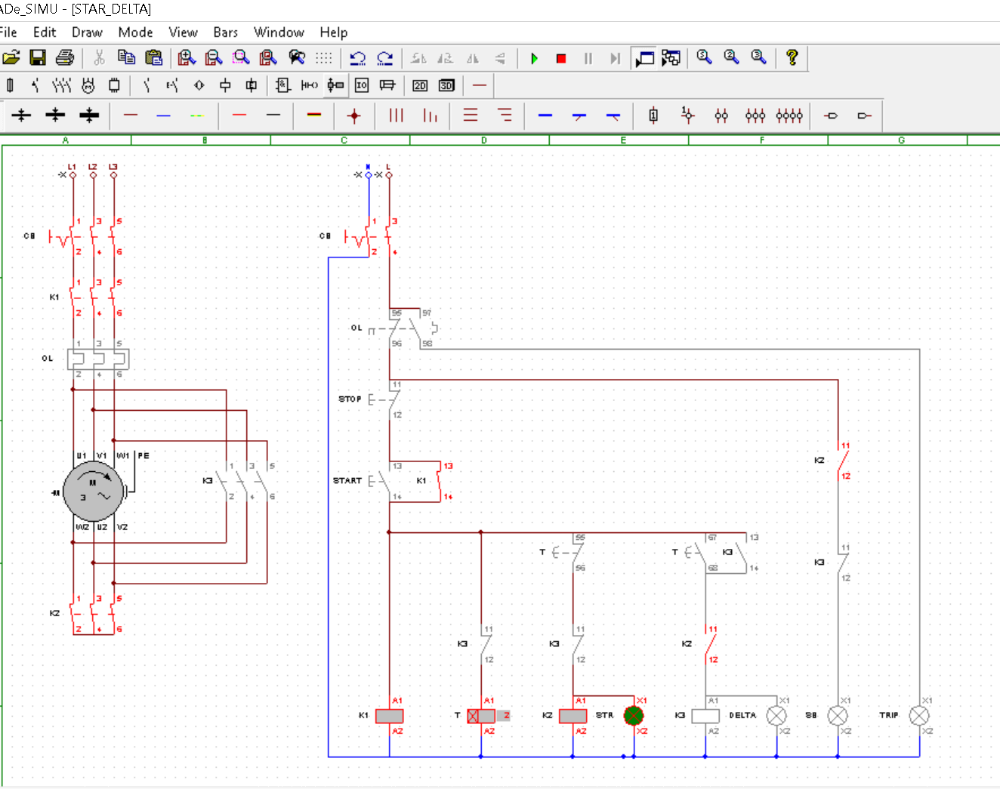

# Star-Delta Motor Starter

A simulated automatic star-delta (wye-delta) starter for a three-phase induction motor, using three contactors and an on-delay timer.

**Tool:** CADe_SIMU | **Status:** Simulated | **Motor supply:** 3-phase | **Control supply:** single-phase

## Overview

A direct-on-line start draws a high inrush current. A star-delta starter reduces it by starting the motor with its windings connected in **star**, which applies about 58% of line voltage to each winding, then switching to **delta** (full voltage) after a set time. Starting current and starting torque both drop to roughly one third of their DOL values during the star stage.

The motor must be wound for delta operation at the supply voltage, and all six winding terminals (U1, V1, W1, U2, V2, W2) must be accessible.

## Circuit diagram



The screenshot was taken while the simulation was running in the star stage: the K1 and K2 coils and the timer are energised and the STR lamp is lit.

## Components

| Label | Component | Function |
|---|---|---|
| CB | Circuit breaker (power) | Isolates and protects the 3-phase supply |
| K1 | Main contactor | Connects the supply to the motor |
| K2 | Star contactor (STR lamp) | Joins the winding ends W2, U2, V2 together |
| K3 | Delta contactor (DELTA lamp) | Connects the windings in delta |
| T | On-delay timer | Sets the time spent in star |
| OL | Thermal overload relay | Motor overload protection |
| M | 3-phase motor (six terminals) | The load |
| CB (control) | 2-pole circuit breaker | Protects the control circuit |
| STOP | Pushbutton (NC) | Stops the motor |
| START | Pushbutton (NO) | Starts the sequence |
| K1 13-14 | Auxiliary contact (NO) | Holds the start sequence in |
| T 55-56 | Timer contact (NC, opens after the delay) | Drops out the star contactor |
| T 67-68 | Timer contact (NO, closes after the delay) | Brings in the delta contactor |
| K2 11-12, K3 11-12 | Auxiliary contacts (NC) | Interlocks between star and delta |
| K3 13-14 | Auxiliary contact (NO) | Holds the delta contactor in |
| SB | Lamp | Standby (motor stopped) |
| TRIP | Lamp | Overload tripped |

## How it works

1. **Start:** press START. K1 is energised and holds itself in with its 13-14 contact.
2. **Star stage:** the timer T and the star contactor K2 are energised at the same time. K2 joins W2, U2 and V2, so the motor starts in star on reduced voltage. The STR lamp turns on.
3. **Changeover:** when the timer reaches its preset, T 55-56 opens and K2 drops out. T 67-68 closes and energises the delta contactor K3 through K2's NC contact.
4. **Delta stage:** K3 connects the windings in delta and seals itself in with K3 13-14. The DELTA lamp turns on. K3's NC contacts open, which switches off the timer and locks K2 out.
5. **Stop:** press STOP to drop everything.
6. **Overload:** OL trips, drops the control circuit and lights the TRIP lamp.

| Stage | K1 | K2 (star) | K3 (delta) | Timer |
|---|---|---|---|---|
| Stopped | Off | Off | Off | Off |
| Star (starting) | On | On | Off | Counting |
| Delta (running) | On | Off | On | Off |

## Interlocking

- K2's NC contact is in K3's coil path, and K3's NC contact is in K2's coil path. Star and delta can never be on together, which would short the supply.
- Once delta is on, the timer and star contactor are locked out until the motor is stopped.

## Running the simulation

1. Open the project file in [CADe_SIMU](https://www.cadesimu.net/).
2. Click **Run**.
3. Press START and watch the STR lamp, then the DELTA lamp after the timer delay. Press STOP to reset.

## Possible improvements

- Add a short gap between star dropping out and delta closing (open transition).
- Add an emergency stop.
- Add a phase failure relay on the supply.

## Skills demonstrated

Reduced-voltage starting, timer-based sequencing, contactor interlocking, reading six-terminal motor connections, overload protection.

## Files

```
05-star-delta-starter/
├── README.md
├── star-delta.cad   (add your CADe_SIMU project file here)
└── images/circuit-diagram.png
```

## Author

Nifemi Akintoye ([GitHub](https://github.com/attommm))

> This is a learning simulation. Real motor circuits must be designed and installed by a qualified electrician in line with local wiring regulations.
